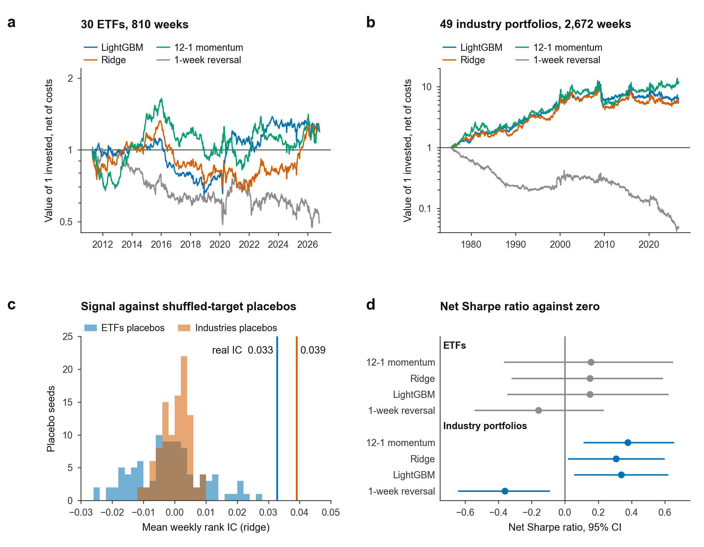
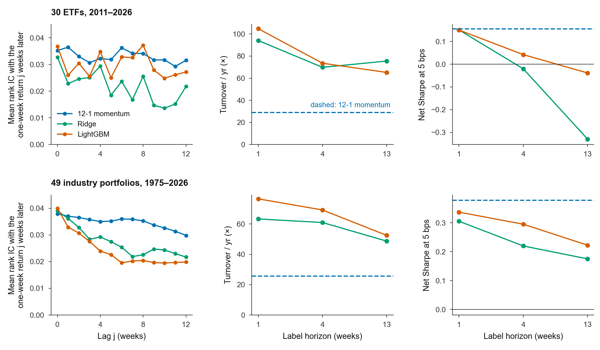

# Weekly equity signals under trading costs

How much of a weekly cross-sectional return forecast is left after trading costs, and can a different
rebalancing rule keep more of it? A pre-specified walk-forward study on 30 ETFs and 49 U.S. industry portfolios.

[](https://github.com/lyz44git/walk-forward-backtest/actions/workflows/tests.yml)



**Figure 1 | Headline results.** **a**, Value of 1 invested in each long-short signal after costs, out of sample, on 49 industry portfolios (log scale); the dashed line splits the sample into halves, labeled with the LightGBM net Sharpe ratio in each. Inset: the same on 30 ETFs. **b**, Mean weekly rank IC of ridge models trained on shuffled targets (100 seeds per dataset) against the real IC (vertical lines), which exceeds every placebo seed. **c**, Net Sharpe ratio with stationary block-bootstrap 95% intervals. Every ETF interval spans zero, so no signal passes the rule fixed in advance on both datasets. **d**, Net Sharpe ratio on ETFs as the assumed one-way trading cost rises from 0 to 10 bps; the reported results use 5 bps. Drawn by [`figures/make_figure1.py`](figures/make_figure1.py) from `reports/`.

> **Takeaways.**
> 1. **Prediction.** Ridge and LightGBM rank next-week returns out of sample (rank IC 0.033–0.040, above every
>    shuffled-target placebo seed). After 5 bps costs they do no better than plain 12-1 momentum, and on tradable
>    ETFs no net Sharpe ratio is distinguishable from zero. Under the pass rule fixed in advance, nothing passes.
> 2. **Rebalancing.** Trading less does not rescue the result at 5 bps. Four simple rules and a PPO policy cut
>    turnover by 31–70% at the same exposure, but give up about as much return before costs as they save in costs:
>    no rule's net Sharpe differs detectably from full rebalancing. The simple rules pay off only at higher
>    costs (10 bps, industry portfolios: +0.11 to +0.19 net Sharpe), and the learned policy never beats them.
> 3. **Why.** The models are mostly momentum. On the industry portfolios their alpha of about 7% a year against
>    market, size and value (t 3.7–3.9) falls to 1.1–1.5% (t 0.9–1.3) once the 12-1 momentum portfolio of the same
>    universe is added. What they add is a faster component that costs 2–3 times momentum's turnover: their
>    breakeven cost is 7–12 bps against 14–29 bps for momentum. Fitting the models to 4- or 13-week returns does
>    not help either. The decision this supports: on price-only features, trade momentum, not the models.

[Reproduce the results](#reproduce) · [Prediction design](#part-1-design) · [Rebalancing design](design/rebalancing_v2_plan.md) · [Diagnostics and label-horizon design](design/label_horizon_plan.md)

**Question.** Do simple price-based features predict next-week relative returns, out of sample and after
trading costs? The same pipeline is run on two public datasets:

- **30 liquid U.S.-listed ETFs** (Yahoo Finance; equity indices, sectors, international, bonds, commodities).
  Out of sample 2011-04 to 2026-10, 810 weeks, entering at the next day's open.
- **49 U.S. industry portfolios** (Kenneth French data library, value-weighted, CRSP-based). Out of sample
  1975-07 to 2026-09, 2,672 weeks, entering at the next day's close.

The design (features, models, hyperparameters, costs, metrics and a pass/fail rule) was written to
`design/preregistration.json` before any out-of-sample number was computed. This is a self-written plan, not
an external registry. A first run was stopped part-way, and five changes were made after a code audit; all
of them are logged, with reasons, in `design/deviations.md`. Models, costs and the pass/fail rule never
changed.

## Part 1. Design

| Element | Choice |
|---|---|
| Rebalance | Weekly. The signal uses the close of the last trading day of the week. |
| Execution | ETFs: enter at the next day's open, exit at the open after the next signal (dividend-adjusted opens). Industries: enter at the next day's close (one-day lag). |
| Features (as of the signal date) | Returns over 5/21/63/126 days, 12-1 momentum, 21/63-day volatility, gap to the 200-day mean, 63-day drawdown, and (ETFs only) a dollar-volume surge. Each is ranked across assets every week. |
| Signals | 12-1 momentum and 1-week reversal (no fitting); ridge (alpha 1); LightGBM (300 trees, 7 leaves, fixed in advance) |
| Training | Expanding window, refit every 4 weeks. Purged: a week is used only after its holding period has ended, plus a 1-week embargo. Initial span 156 / 260 weeks. |
| Portfolio | Long the top 20%, short the bottom 20%, equal weight, 100% per leg; weights drift between rebalances |
| Costs | 5 bps one-way × turnover, plus 50 bps/yr borrow on the short side (grid: 0/2/5/10 bps) |
| Inference | Newey-West t for the mean rank IC; stationary block-bootstrap 95% CI for Sharpe; deflated Sharpe (N = 4); alpha vs the equal-weight universe's excess return |
| Pass rule (fixed in advance) | On both datasets: mean IC > 0 with t > 2, and the net Sharpe CI excludes 0 |

## Part 1. Results (`reports/main_results.csv`, `reports/decision.csv`)

| Dataset | Signal | Mean IC (NW t) | Sharpe before costs | Sharpe after costs (95% CI) | Turnover / yr |
|---|---|---|---|---|---|
| ETFs | 12-1 momentum | 0.035 (2.6) | 0.27 | 0.16 (−0.37, 0.65) | 29× |
| ETFs | Ridge | 0.033 (2.7) | 0.48 | 0.15 (−0.32, 0.59) | 94× |
| ETFs | LightGBM | 0.037 (3.6) | 0.58 | 0.15 (−0.35, 0.62) | 105× |
| ETFs | 1-week reversal | 0.016 (1.4) | 0.31 | −0.16 (−0.54, 0.23) | 159× |
| Industries | 12-1 momentum | 0.038 (6.8) | 0.49 | 0.38 (0.11, 0.65) | 26× |
| Industries | Ridge | 0.039 (7.6) | 0.55 | 0.31 (0.02, 0.60) | 63× |
| Industries | LightGBM | 0.040 (8.6) | 0.66 | 0.34 (0.05, 0.62) | 77× |
| Industries | 1-week reversal | 0.008 (1.8) | 0.25 | −0.36 (−0.64, −0.09) | 159× |

**What this shows**

1. **The prediction signal is real.** Ridge and LightGBM have a significant out-of-sample rank IC on both
   datasets. In a placebo test (training targets shuffled within each week, with a fresh shuffle at every
   refit) the real IC is above every placebo seed: ridge 100 of 100 seeds, LightGBM 10 of 10
   (`reports/placebo_summary.csv`, `fig2`). The placebo also shows that the Newey-West t over-rejects on the short
   ETF sample (|t| > 2 in 20% of LightGBM and 6% of ridge placebo seeds), so the ETF t-statistics of 2.6–3.6 are
   weaker evidence than they look.
2. **It survives costs only on the industry portfolios, which cannot be traded directly** (their 5 bps cost
   is an assumption).
   - Industries: model net Sharpe 0.31–0.34 (12-1 momentum 0.38), with CIs above zero, and an intercept of
     about 6% a year against the equal-weight universe's excess return (t 3.0–3.3; one benchmark, no
     momentum-factor control).
   - With features lagged one more week, the industry models' CIs include zero.
   - ETFs: net Sharpe is 0.15, and every CI spans zero. LightGBM's before-cost Sharpe of 0.58 is used up by
     about 100× annual turnover.
3. **The models do not beat plain 12-1 momentum after costs.** They rank slightly better (higher IC), but
   they trade two to three times as much.
4. **Verdict under the pass rule fixed in advance: no signal passes on both datasets.** The result is reported as not robust.
   Deflated Sharpe probabilities are 0.33–0.52.
5. **The edge decays.**
   - Industries: model net Sharpe is 0.6–0.7 in 1975–2001 and 0.09 in 2001–2026 (`reports/halves.csv`).
   - 1-week reversal loses money after costs on both datasets.

**Robustness** (`reports/robustness.csv`, `reports/cost_grid.csv`)
- **Features lagged one extra week:** the momentum and model ICs barely change (the signals are slow);
  reversal disappears. On industries the ridge and LightGBM net Sharpe CIs now include zero (lower bounds −0.03 and
  −0.02); on ETFs LightGBM's net Sharpe turns negative (−0.11).
- **ETFs entered at the next close instead of the next open:** the ICs barely change, but LightGBM's net Sharpe
  turns negative (−0.09); momentum and ridge stay near 0.15–0.19, with CIs spanning zero as before.
- **Costs:**
  - At 10 bps the ETF models turn negative.
  - Industry momentum keeps a net Sharpe of 0.30.

## Part 2. Rebalancing rules (`reports/rebalancing/`)

Part 1 leaves a question: the models lose half or more of their Sharpe ratio to costs, because they turn the book
over 63–105 times a year. Part 2 holds the signals, trading dates and cost model of Part 1 fixed and
changes only how the weekly target is traded. The plan, [`design/rebalancing_v2_plan.md`](design/rebalancing_v2_plan.md),
was committed before any number below was computed.


**Figure 2 | What trading less is worth.** Left, net Sharpe ratio of each rule minus full rebalancing, averaged over the three signals (12-1 momentum, ridge, LightGBM), with paired stationary-bootstrap 95% intervals at 5 bps (filled) and 10 bps (open); annual turnover at 5 bps and its change from full rebalancing are on the right of each row. Right, mean net Sharpe ratio against the assumed one-way cost; rule parameters are re-selected on the training span at each cost, and the PPO policy is the one trained at 5 bps. Drawn by [`figures/make_figure2.py`](figures/make_figure2.py) from `reports/rebalancing/`.

| Element | Choice |
|---|---|
| Cases | 2 datasets × 3 signals, with the Part 1 walk-forward predictions and targets |
| Spans | ETFs: select 2012-04 to 2018-12, test 2019-01 to 2026-10 (408 weeks). Industries: select 1976-07 to 2000-12, test 2001-01 to 2026-09 (1,342 weeks) |
| Full rebalancing | Trade to the target every week (the Part 1 portfolio) |
| Partial adjustment | Trade a fixed fraction of the gap between holdings and target |
| No-trade band | Per asset, trade only to the edge of a band around its target weight |
| Rank buffer | A held name stays in its leg while it ranks inside a wider quantile; vacancies go to the best-ranked names |
| Signal smoothing | Exponentially weighted mean of past weekly predictions, then the usual top and bottom 20% |
| PPO policy | Actor-critic with a Beta policy over the adjustment fraction, 9 state features known at the signal date, written in PyTorch; 5 seeds, trained on the selection span only, with gradients averaged across 8 processes (`torch.distributed`) |
| Selection | Each rule's one parameter is chosen by net Sharpe on the selection span, among values that keep the short-leg notional within 0.90–1.10 of target |
| Estimand | Per dataset: mean over the three signals of net Sharpe (rule) − net Sharpe (full), with a stationary bootstrap that resamples the same weeks for every series (mean block 8 weeks, 2,000 draws) |
| Reading rule (fixed in advance) | A rule recovers performance only if its interval is above zero on both datasets |

Test-span results at 5 bps, averaged over the three signals (`rules_results.csv`, `rules_pooled.csv`):

| Dataset | Rule | Turnover / yr | Return before costs | Costs | Net Sharpe | Difference from full, 5 bps (95% CI) | Difference from full, 10 bps (95% CI) |
|---|---|---|---|---|---|---|---|
| ETFs | Full rebalancing | 73× | 11.3% | 4.2% | 0.42 | — | — |
| ETFs | Partial adjustment | 30× | 7.8% | 2.0% | 0.39 | −0.03 (−0.18, +0.14) | +0.09 (−0.08, +0.27) |
| ETFs | No-trade band | 49× | 9.3% | 3.0% | 0.39 | −0.03 (−0.14, +0.09) | +0.04 (−0.07, +0.16) |
| ETFs | Rank buffer | 27× | 8.5% | 1.9% | 0.41 | −0.02 (−0.22, +0.20) | +0.12 (−0.10, +0.35) |
| ETFs | Signal smoothing | 43× | 7.3% | 2.7% | 0.27 | −0.15 (−0.35, +0.05) | +0.05 (−0.20, +0.32) |
| ETFs | PPO policy | 22× | 5.5% | 1.6% | 0.26 | −0.17 (−0.39, +0.07) | −0.02 (−0.24, +0.22) |
| Industries | Full rebalancing | 55× | 5.8% | 3.2% | 0.14 | — | — |
| Industries | Partial adjustment | 34× | 4.8% | 2.2% | 0.15 | +0.01 (−0.04, +0.06) | +0.11 (+0.02, +0.20) |
| Industries | No-trade band | 28× | 5.4% | 2.0% | 0.23 | +0.09 (−0.01, +0.19) | +0.19 (+0.07, +0.30) |
| Industries | Rank buffer | 20× | 4.7% | 1.5% | 0.19 | +0.04 (−0.05, +0.15) | +0.15 (+0.06, +0.26) |
| Industries | Signal smoothing | 28× | 5.0% | 1.9% | 0.17 | +0.03 (−0.05, +0.12) | +0.15 (+0.03, +0.27) |
| Industries | PPO policy | 38× | 4.6% | 2.4% | 0.13 | −0.01 (−0.07, +0.04) | +0.03 (−0.03, +0.09) |

**What this shows**

1. **Every rule trades much less at the same exposure.** Turnover falls by 33–70% on ETFs and 31–63% on
   industries, with the short leg between 0.90 and 1.11 of target on the test span.
2. **At 5 bps the saving is offset by lost return.** On ETFs the rank buffer saves 2.3 points of costs a year
   and gives up 2.8 points of return before costs. No interval excludes zero on either dataset; under the
   reading rule, no rule recovers performance. Part 3 looks at where the lost return comes from.
3. **The value of trading less rises with the cost.** At 10 bps all four simple rules beat full rebalancing on
   the industry portfolios (+0.11 to +0.19, intervals above zero); the ETF intervals still include zero. The cost
   grid is a pre-specified sensitivity, not the headline.
4. **The learned policy adds nothing over the simple rules.** Averaged over signals, PPO is below every
   simple rule on both datasets; on industries it is worse than the no-trade band (−0.10, interval −0.19 to −0.02). The cost drag in Part 1 is
   not something a trading rule removes.
5. **Block length does not matter.** With mean blocks of 4 and 16 weeks every 5 bps conclusion is unchanged.

**How this design came about.** A first design ([`design/rebalancing_v1_preregistration.md`](design/rebalancing_v1_preregistration.md),
results in `reports/rebalancing/v1/`) compared full rebalancing, partial adjustment, a no-trade band and PPO, with
PPO meeting its improvement rule in 0 of 18 comparisons. A check of its weekly output showed that selecting the band
width by Sharpe alone admitted a degenerate rule: a band as wide as a position never opens one, and the selected ETF
LightGBM band held 3% of its target exposure, with a return of exactly zero in 359 of 408 weeks. The second design
adds the exposure constraint, two rules that stay fully invested by construction, a pooled estimand and paired
intervals. It was written after the first test-span results were known, so it is a second iteration on a span that
had been looked at once.

**Distributed training.** The same PPO script runs in one process or under `torchrun`. On one machine, one seed
of one case took 91 s in one process and 56 s in eight, with identical parameters, weekly actions and test metrics
(`v1/timing.csv`, `v1/distributed_parity.csv`).

## Part 3. Where the cost drag comes from (`reports/diagnostics/`, `reports/horizon/`)

Part 2 was first read as evidence that the forecasts are short-lived, so that a position that is not refreshed
loses its edge. That reading was an inference, and the plan for this part
([`design/label_horizon_plan.md`](design/label_horizon_plan.md), committed before any number below) stated what
would contradict it. The diagnostics did contradict it, and the explanation was changed.



**Figure 3 | Decay and label horizon.** Left, mean rank IC of the week-t prediction with the one-week return j weeks later, for the Part 1 predictions. Middle and right, annual turnover and net Sharpe ratio at 5 bps when ridge and LightGBM are fitted to 1-, 4- and 13-week forward returns (1 week is Part 1); the dashed line is 12-1 momentum. Full out-of-sample span of Part 1. Drawn by [`figures/make_figure3.py`](figures/make_figure3.py).

**Step A. Diagnostics of the Part 1 predictions** (no refitting; `scripts/11_signal_diagnostics.py`)

| Diagnostic | ETFs | Industries |
|---|---|---|
| Rank IC at lag 0 → 1 → 12 weeks, ridge | 0.033 → 0.023 → 0.022 | 0.039 → 0.036 → 0.022 |
| Rank IC at lag 0 → 1 → 12 weeks, LightGBM | 0.037 → 0.026 → 0.027 | 0.040 → 0.033 → 0.020 |
| Rank IC at lag 0 → 1 → 12 weeks, 12-1 momentum | 0.035 → 0.036 → 0.032 | 0.038 → 0.037 → 0.030 |
| One-week rank autocorrelation of predictions: models / momentum | 0.58–0.67 / 0.96 | 0.74–0.84 / 0.97 |
| Quintile returns in order (adjacent pairs out of 4) | 3–4 | 4 |
| Breakeven one-way cost, full sample: models / momentum | 6.9–7.5 bps / 14.1 bps | 10.9–12.1 bps / 29.4 bps |
| Alpha vs market, size, value: models (per year, Newey-West t) | −3.0% to −3.2% (t −0.8 to −1.1) | 6.8% to 7.1% (t 3.7 to 3.9) |
| Alpha after adding same-universe 12-1 momentum | −3.1% to −3.3% (t −1.1 to −1.2) | 1.1% to 1.5% (t 0.9 to 1.3) |
| Loading on same-universe momentum (R²) | 0.20–0.47 (0.32–0.46) | 0.65–0.73 (0.66–0.69) |

1. **The predictions are not short-lived.** A 12-week-old model prediction keeps 50–74% of the IC of a fresh
   one. The short-lived part is the step from lag 0 to lag 1 (7–30% of the IC); after that the decay is slow.
2. **The models are mostly momentum plus a fast component.** On industries, a regression on the factors
   and the same-universe momentum portfolio explains two thirds of the variance of the model portfolios, and the alpha left after it is not distinguishable
   from zero. Model rankings reshuffle far more from week to week than momentum's (autocorrelation 0.58–0.84
   against 0.96–0.97), which is where the extra turnover comes from.
3. **This is what Part 2 measured.** A rule that trades less keeps the persistent, momentum-like part and drops
   the fast part; at 5 bps the fast part earns about what it costs to trade.
4. **The ETF long-short portfolios carry market exposure.** Their market beta is 0.35–0.44 (long equities, short
   bonds and commodities much of the time), and their alpha is negative and not significant. The Part 1 ETF
   Sharpe ratios are therefore not market-neutral numbers.

**Step B. Longer label horizons** (`scripts/12_label_horizon.py`; the one-week run reproduces Part 1 exactly)

| Dataset | Label | Rank IC vs one-week return (ridge / LightGBM) | Turnover / yr | Net Sharpe at 5 bps | Mean difference from 1 week (95% CI) |
|---|---|---|---|---|---|
| ETFs | 1 week | 0.033 / 0.037 | 94× / 105× | 0.15 / 0.15 | — |
| ETFs | 4 weeks | 0.026 / 0.036 | 70× / 74× | −0.02 / 0.04 | −0.14 (−0.44, +0.18) |
| ETFs | 13 weeks | 0.010 / 0.031 | 76× / 65× | −0.33 / −0.04 | −0.33 (−0.73, +0.08) |
| Industries | 1 week | 0.039 / 0.040 | 63× / 77× | 0.31 / 0.34 | — |
| Industries | 4 weeks | 0.035 / 0.035 | 61× / 69× | 0.22 / 0.30 | −0.06 (−0.17, +0.04) |
| Industries | 13 weeks | 0.034 / 0.034 | 49× / 52× | 0.18 / 0.22 | −0.12 (−0.27, +0.02) |

Under the reading rule fixed in advance, a longer label does not keep more net performance: both primary
intervals (4 weeks) include zero and both point estimates are negative. With a 4-week label turnover falls by 4–30%,
still more than twice momentum's, and the IC against the one-week return falls with it. The conclusions are the same with mean
blocks of 4 and 16 weeks and on the Part 2 test span alone (`horizon_pooled.csv`).

**What the three parts say together.** The price-based models rank returns out of sample, but what they add to
12-1 momentum is a fast component that does not pay for its turnover, and three ways of slowing them down
(rebalancing rules, a learned policy, longer labels) leave net performance statistically unchanged or lower.
On these features and universes the supported choice is plain momentum; a better result would need information
that momentum does not already contain, not a different model or trading rule on the same prices.

## Verification

- **Tests:** 25 pytest tests on synthetic data (`tests/`). Eight check the engine: features use no future
  prices, the target spans exactly entry → exit, purging works, pure noise gives no skill, a planted lagged
  signal is found, and the long-short accounting is correct. Ten check the rebalancing rules: cost and
  borrow accounting, that the neutral parameter of each rule returns the Part 1 targets, that both legs stay
  full and disjoint, that a rule cannot see later predictions, and that the degenerate band is caught. Seven check the
  label horizon: the target spans entry to the exit of the last label week, predictions do not move when every
  price after the signal date is rewritten, and a purge that ignored the label length is shown to leak. Seven
  more run when the cached targets are present: full rebalancing reproduces `reports/ls_weekly.csv` to 1e-12
  for all six cases, and the PPO state uses only completed weeks.
- **Regeneration:** after the rebalancing code was merged, the Part 1 weekly returns and all five first-design
  result files were regenerated byte for byte.
- **Code review:** a structured review by lens (timing and look-ahead, walk-forward, accounting, statistics,
  data) found two material errors, both fixed before the reported run: a placebo that reused one permutation
  across refits and an alpha regression that did not subtract the risk-free rate. Three lower-priority issues were
  also fixed. All five changes are in `design/deviations.md`.
- **Independent recomputation:** `scripts/06_recompute_check.py` recomputes the mean IC, Newey-West t, hit rate,
  gross and net Sharpe, net return and turnover for all eight dataset-signal pairs from the saved weekly series,
  with formulas written separately from the package. The largest difference from the reported values is 1.4e-14
  (`reports/recompute_check.csv`). It also redraws the Sharpe bootstrap with 20 seeds: whether the CI excludes
  zero does not depend on the seed for any signal (`reports/bootstrap_seed_sensitivity.csv`).
- **Data quality:** `reports/data_quality.json` covers calendar gaps, split and dividend adjustments, and
  large moves; every outlier traced to a real market event.

## Limitations

- **Survivorship and selection bias.** The ETF universe is today's 30 surviving funds; no fund can drop out.
- **Execution.** Prices are Yahoo's consolidated opens. Some crisis-day opens may not have been tradable at
  size. Industry portfolios are not tradable, so their costs are hypothetical.
- **No capacity or market-impact model.** Borrow cost is a flat 50 bps a year.
- **Weekly horizon, price-only features.** No fundamental, options or intraday data.

## Reproduce

```bash
pip install -r requirements.txt
python3 scripts/01_download.py      # Yahoo (yfinance) + Ken French files into data/raw (git-ignored)
python3 scripts/02_check_data.py
python3 -m pytest tests -q
python3 scripts/03_backtest.py      # ~35 min on a 32-core machine
python3 scripts/04_placebo.py && python3 scripts/04_placebo.py --summary
python3 scripts/05_figures.py
python3 scripts/06_recompute_check.py   # reads reports/ only

# Part 2
python3 scripts/07_build_targets.py     # weekly targets of the six cases into tmp/rebalance
pip install -r requirements-ppo.txt     # PyTorch, only for the PPO policy
scripts/run_ppo.sh main                 # 5 seeds x 6 cases, 8 processes
python3 scripts/09_rebalancing_rules.py # all rules, cost grid, paired intervals (about 30 s)
python3 scripts/10_ppo_v1_evaluate.py   # first-design tables, parity check and timing
python3 figures/make_figure2.py

# Part 3
python3 scripts/11_signal_diagnostics.py                     # decay, quintiles, breakeven cost, attribution
for h in 1 4 13; do for s in ridge lgbm; do for d in etf french; do
  python3 scripts/12_label_horizon.py fit --dataset $d --signal $s --horizon $h   # LightGBM on industries: ~16 min each
done; done; done
python3 scripts/12_label_horizon.py summarize
python3 figures/make_figure3.py
```

Raw data are not redistributed: Yahoo data are for personal use, and the Ken French files can be downloaded
from the library.

## License

Code is released under the MIT License (see `LICENSE`). Yahoo Finance and Kenneth French data are not covered and
are not redistributed here.

**Use.** This is a non-commercial research project. The data and all derived outputs in this repository are used
for research only.

## Notes

Developed with an AI-assisted coding workflow. The research questions, analysis plans and interpretation of results
were led by the author.

## Layout

```
design/             preregistration.json and deviations.md (Part 1); rebalancing_v2_plan.md, rebalancing_v1_* (Part 2);
                    label_horizon_plan.md (Part 3)
src/qmb/            data.py (loaders), engine.py (schedule, features, walk-forward, portfolios), stats.py (metrics)
src/qmb/rebalance/  cases.py (targets), env.py (accounting, simulator), rules.py (rank buffer, smoothing), ppo.py, splits.py
scripts/            01 download · 02 data checks · 03 backtests + robustness · 04 placebo · 05 figures · 06 recompute check
                    07 targets · 08 PPO training · 09 rebalancing rules · 10 first-design evaluation
                    11 signal diagnostics · 12 label horizons
tests/              synthetic-data tests of the engine and the rebalancing rules
reports/            result tables (CSV/JSON) and figures; reports/rebalancing/ (Part 2); reports/diagnostics/, reports/horizon/ (Part 3)
data/, tmp/         raw and clean data, caches, logs (git-ignored)
```
